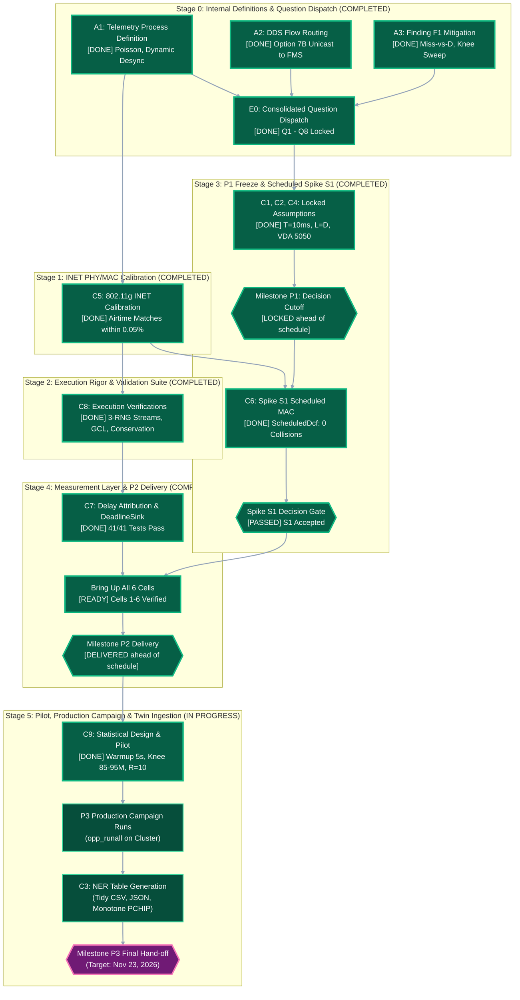

# Matrix Factory Twin: Master Execution Schedule & Dependency Roadmap

**Document Reference:** Operational roadmap integrating [`Matrix Factory TwinImplementation Guide.md`](../Matrix%20Factory%20TwinImplementation%20Guide.md), [`docs/decisions.md`](decisions.md), [`docs/parameters.md`](parameters.md), and [`docs/checklist_secao3.md`](checklist_secao3.md).  
**Time Horizon:** Oct 13, 2026 &rarr; Nov 23, 2026  
**Key Milestones:**
* **P1 Milestone:** Oct 26, 2026 (Decisions & Working Assumptions Frozen)
* **P2 Milestone:** Nov 09, 2026 (Six Operational Cells, Scheduled MAC / Fallback, Hand-off Package)
* **P3 Milestone:** Nov 23, 2026 (Production Simulation Campaign & Digital Twin NER Lookup Tables)

**Status update (Oct 15, 2026):**
* **All eight questions (Q1–Q8) are formally locked** with maintainer ground truth and supervisor approval (see [`docs/decisions.md`](decisions.md) §2).
* **INET Calibration (Checklist C5) [COMPLETED]:** Unloaded baseline verified across 54, 24, 12, and 6 Mbps against [`docs/capacity.md`](capacity.md) within 0.05% error (see [`docs/results.md`](results.md) §1).
* **Execution Rigor (Checklist C8) [COMPLETED]:** Three-stream RNG isolation (`rng-0` MAC, `rng-1` traffic, `rng-2` AMR coordinates), 22/22 GCL rules, and packet conservation laws verified (see [`docs/results.md`](results.md) §2).
* **Spike S1 Scheduled MAC (Checklist C6) [COMPLETED]:** `ScheduledDcf` implemented in C++, compiled into `libmatrixfactory.so`, and passed acceptance testing with 0 collisions across 2.82M frames at $N=40$ and latency bounded by $T_{\text{super}} = 20\text{ ms}$ (see [`docs/results.md`](results.md) §3).
* **Measurement Layer & DeadlineSink (Checklist C7) [COMPLETED]:** `DeadlineSink` implemented with online continuous (Def A) and discrete tick-quantized (Def B) miss counting, domain latency attribution, and 41/41 passing unit tests (see [`docs/results.md`](results.md) §4).
* **Statistical Pilot Run (Checklist C9) [COMPLETED]:** 5.0 s warmup validated across 338k vector samples, FIFO saturation knee empirically localized between 85.0 and 95.0 Mbps (confirming Finding F1), and Jain $R=10$ replication sizing confirmed (see [`docs/results.md`](results.md) §5).
* **Current Active Frontier:** Launching the 4,800-run P3 Production Campaign (`opp_runall -j$(nproc)`) and generating the dual-table NER lookup export (Checklist C3).

---

## 1. High-Level Dependency Graph & Critical Path



---

## 2. Chronological Schedule & Prerequisites Matrix

The master progression is structured into 6 sequential stages. For each stage, the table explicitly separates **what must be defined before starting** from **what must be executed**.

```
Stage 0 (Oct 13-16)  -->  Stage 1 (Oct 17-20)  -->  Stage 2 (Oct 21-25)
Internal Definitions       802.11 Calibration       Backbone Verification
         |                         |                         |
         v                         v                         v
Stage 3 (Oct 26-Nov 02) -> Stage 4 (Nov 03-09)  -->  Stage 5 (Nov 10-23)
P1 Freeze & Spike S1       DeadlineSink & P2         Pilot, P3 & NER Export
```

---

### Stage 0: Groundwork, Model Formulations & Question Dispatch
**Window:** Oct 13 &rarr; Oct 16, 2026 (Week 1)  
**Objective:** Eliminate ambiguity, freeze mathematical definitions, and formally transmit questions Q1–Q8.

| Task ID | What We Need to DEFINE Before Doing It | What We Need to DO | Owner | Target Date | Done When / Exit Criterion |
| :---: | :--- | :--- | :---: | :---: | :--- |
| **A1** | * Mathematical inter-arrival model: Poisson ($\text{Var} = 1/\lambda^2$) to enforce stochastic queue bursts at $\rho \approx 0.82$ (conservative for FIFO).<br>* Station scaling: 4 stations transmitting $1400\ \text{B}$ frames yield aggregate payloads of $22.4$, $74.7$, and $149.3\ \text{Mbps}$.<br>* Dynamic phase offset range: $\mathcal{U}(0, \lambda^{-1})$ per station. | 1. Update `simulations/omnetpp.ini` to set `productionInterval = exponential(${telInterval})` and `initialProductionOffset = uniform(0s, ${telInterval})`.<br>2. Confirm identical generator structure across `[Config Point]` and `[Config Sweep]`. | Team | Oct 14 | INI applies Poisson arrivals and dynamic offsets; initial transmission bursts at $t=0$ are eliminated across all 4 stations. |
| **A2** | * Exact traffic destination for DDS: Station unicast ring ($i \to (i+1)\%4$) vs. FMS subscription.<br>* Port contention topology fact: In a ring, DDS traverses dedicated switch egress ports and experiences zero queuing contention with telemetry. | 1. Configure `*.station[*].app[0].io.destAddress` to unicast ring in `omnetpp.ini`.<br>2. Formulate inquiry in Q7 regarding whether FMS subscribes to DDS.<br>3. Document port isolation in `decisions.md` §4. | Team | Oct 14 | Every DDS flow has explicit source-destination binding; DDS volume confirmed at 400 pkts/s ($22,000$ per run). |
| **A3** | * Finding F1 analytical bounds: At $100\ \text{Mbps}$ and $B = 80$, max wired queuing delay is $9.408\ \text{ms} \ll D = 50\ \text{ms}$.<br>* Primary outcome representation: Continuous Miss-vs-$D$ curve across $D \in \{1, 2, 5, 10, 20, 50, 100\}\ \text{ms}$ (two-tier framework, Q2).<br>* Saturation knee sweep range: Densify $\lambda$ across $70\ \text{to } 110\ \text{Mbps}$ wire load ($8\text{ to }10$ points). | 1. Draft the Miss-vs-$D$ reporting policy in `decisions.md` §1.7.<br>2. Add Q8 to the questions dossier.<br>3. Compute estimated simulation cost for densified parameter grid. | Team | Oct 15 | Evaluation grid avoids $0.000\%$ degeneracy; Miss-vs-$D$ evaluation pipeline designed. |
| **E0** | * Consolidated technical dossier for Q1 through Q8, incorporating normative citations (3GPP TS 22.104, 5G-ACIA, VDA 5050 v3.0.0, OMG DDS v1.4, RFC 768/9293).<br>* Analytical proofs from `decisions.md` and capacity tables from `capacity.md`. | 1. Format formal dispatch package for the open items (Q2 TTL constants and State lead time, Q3 ingestion details, Q4 and Q5 notices, Q6 to Q8); Q1 and Q3 were already answered by the maintainers on Oct 14.<br>2. Email Prof. Dr. Antônio Augusto Medeiros Fröhlich and twin maintainers.<br>3. Log dispatch date in `decisions.md` §2.<br>4. Set strict cutoff date of Oct 26, 2026. | Team | Oct 16 | Package sent; dispatch timestamp and response cutoff logged in `decisions.md`. |

---

### Stage 1: Wireless Channel & INET 802.11 Calibration
**Window:** Oct 17 &rarr; Oct 20, 2026 (Week 1–2)  
**Objective:** Calibrate INET's physical and MAC layer timings against theoretical models.

| Task ID | What We Need to DEFINE Before Doing It | What We Need to DO | Owner | Target Date | Done When / Exit Criterion |
| :---: | :--- | :--- | :---: | :---: | :--- |
| **C5** | * Analytical baseline exchange times ([`docs/capacity.md`](capacity.md)): $325.5\ \mu\text{s}$ (State, 1000 B) and $265.5\ \mu\text{s}$ (Orders, 600 B) at 54 Mbps ERP-OFDM.<br>* INET PHY constants: Short slot ($9\ \mu\text{s}$), SIFS ($10\ \mu\text{s}$), DIFS ($28\ \mu\text{s}$), 20 µs preamble, and two 6 µs signal extensions.<br>* Error-free scope decision: $20\ \text{mW}$ transmitter, $-110\ \text{dBm}$ noise floor. | 1. Execute unloaded baseline simulation (Cell 1, $N = 1$, no telemetry):<br>`opp_run -c Cell1 -u Cmdenv '--*.numAmrs=1' omnetpp.ini`<br>2. Measure exact `frameSequenceDuration` for State and Orders across 54, 24, 12, and 6 Mbps.<br>3. Check INET internal variables: `opMode = "g(erp)"`, ACK bitrate ($24\ \text{Mbps}$), and signal extension.<br>4. Update `analysis/capacity.py` with measured values and regenerate `docs/capacity.md`.<br>5. Calibrate base `slotDuration` for Spike S1. | Team | Oct 20 | Simulated frame exchange times agree with `capacity.md` within 2%; base slot duration for Spike S1 determined ($326\ \mu\text{s} + \text{guard} \approx 400\ \mu\text{s}$). |

---

### Stage 2: Backbone Execution Rigor & Validation Suite
**Window:** Oct 21 &rarr; Oct 25, 2026 (Week 2)  
**Objective:** Prove simulation execution parity, verify GCL gate operations, and ensure lossless accounting.

| Task ID | What We Need to DEFINE Before Doing It | What We Need to DO | Owner | Target Date | Done When / Exit Criterion |
| :---: | :--- | :--- | :---: | :---: | :--- |
| **C8** | * Load parity rule: Identical offered packet generation across Cells 1, 3, 5 for a given seed.<br>* RNG stream separation architecture: `rng-0` (protocols) vs. `rng-1` (traffic sources).<br>* GCL window schedule: $[0, 100)\ \mu\text{s}$ (Orders), $[100, 300)\ \mu\text{s}$ (DDS), $[300, 500)\ \mu\text{s}$ (State), $[500, 1000)\ \mu\text{s}$ (Telemetry).<br>* Frame encapsulation sizes: $70\ \text{B}$ tagged vs. $66\ \text{B}$ stripped.<br>* Categorical drop bins: `Drop_Queue`, `Drop_Retry`, `Drop_Other`, `Late_Arrival`. | 1. **Load Parity Check:** Run Cells 1, 3, 5 with seed 0; verify first 1,000 packet generation timestamps are identical bit-for-bit.<br>2. **Mobility Stream Isolation:** Decouple AMR spatial coordinates from `rng-0` (create dedicated RNG stream or fix static positions) so MAC backoff doesn't perturb geometry.<br>3. **Gate State Tracing:** Record `gateState:vector` in Cell 5; confirm open/closed intervals match 1000 µs GCL.<br>4. **Tag Overhead Check:** Verify pcap frames exiting switch to AP measure 66 B (tag stripped).<br>5. **Conservation Validation:** Audit packet totals: verify $n_{\text{valid}} = n_{\text{on\_time}} + \sum n_{\text{drop}} + n_{\text{late}}$ for all runs.<br>6. **Port Contention Audit:** Confirm queue accumulation occurs exclusively on `switch &rarr; FMS` port. | Team | Oct 23 | All 6 validation checks pass; AMR positions isolated from protocol RNG; packet conservation holds with zero untracked drops. |

---

### Stage 3: Milestone P1 Freeze & Spike S1 (Scheduled Wireless)
**Window:** Oct 26 &rarr; Nov 02, 2026 (Week 3)  
**Objective:** Freeze working assumptions at the P1 boundary and implement conflict-free wireless MAC.

| Task ID | What We Need to DEFINE Before Doing It | What We Need to DO | Owner | Target Date | Done When / Exit Criterion |
| :---: | :--- | :--- | :---: | :---: | :--- |
| **P1 Gate** / **C1, C2, C4** | * Response cutoff policy: If no reply by Oct 26, adopt documented working assumptions without blocking.<br>* Fixed model values: $T = T_{\min} = 10\ \text{ms}$, $c = \lceil (g + L_c)/T \rceil T$ and $a \le c$ (maintainer-confirmed Oct 14), $L_c = D_c$ (working choice, State lead time to confirm), open-loop UDP (decided Oct 14), $N \in \{5, 10, 20, 40, 80\}$ (Q5, approved Oct 14), 3GPP TS 22.104 deadline baselines as Tier 1 markers.<br>* VDA 5050 schema-based byte sizes ($1000\ \text{B}$ State at 10 Hz; $600\ \text{B}$ Orders at 5 Hz). | 1. Review incoming feedback from supervisors/maintainers.<br>2. If unanswered, lock working assumptions in `decisions.md` §2 and `parameters.md` §6.<br>3. Update status from "Proposed" to "Decision" across all frozen items.<br>4. Re-run `analysis/check_parameters.py`. | Team | **Oct 26 (Milestone P1)** | Assumptions formally locked; parameters consistency verified; model parameters frozen for P2 development. |
| **C6 (Spike S1)** | * Dynamic superframe sizing policy: Superframe cannot be static 100 ms (forces 50 ms mean wait, consuming entire deadline). Must scale with $N$:<br>  - $N=5 \implies T_{\text{super}} = 3\ \text{ms}$ ($1.5\ \text{ms}$ wait)<br>  - $N=10 \implies T_{\text{super}} = 5\ \text{ms}$ ($2.5\ \text{ms}$ wait)<br>  - $N=20 \implies T_{\text{super}} = 9\ \text{ms}$ ($4.5\ \text{ms}$ wait)<br>  - $N=40 \implies T_{\text{super}} = 20\ \text{ms}$ ($10.0\ \text{ms}$ wait)<br>  - $N=80 \implies T_{\text{super}} = 48\ \text{ms}$ ($24.0\ \text{ms}$ mean wait; maximum wait approaches the $50\ \text{ms}$ deadline)<br>* Slot allocation: $0.4\ \text{ms}$ slot duration; dedicated AMR uplink slots + AP downlink slots.<br>* Synchronization phase: Transmission from switch to FMS must start within $[300, 414.4)\ \mu\text{s}$ of GCL cycle (114.4 µs window).<br>* Airtime parity principle: Maintain standard 802.11 preamble, headers, SIFS, ACK exchanges; eliminate only CSMA backoff and collisions ($\text{CW} = 0$).<br>* **Day 18 Decision Rule (Oct 29):** If S1 fails tests 1–2 by Oct 29, trigger fallback to S2 (custom MAC) or S3 (abstract TDMA link). | 1. Create C++ module `src/ScheduledDcf.h`, `.cc`, and `.ned` inheriting from INET's `Dcf`.<br>2. Override `channelGranted`: enforce transmission strictly within assigned slot index; release channel outside slot.<br>3. Configure in `omnetpp.ini`: `mac.dcf.typename = "ScheduledDcf"`, assign `slotIndex`, and set `cwMin = cwMax = 0`.<br>4. Execute Acceptance Tests:<br>  - Test 1: Zero collisions/retries at $N = 40$ saturated AMRs.<br>  - Test 2: Single-AMR frame exchange equals analytical model with $\text{CW} = 0$ ($258\ \mu\text{s}$ for State).<br>  - Test 3: Maximum State delay bounded by $T_{\text{super}}$.<br>5. Delete `SCHEDULED_MAC_NOT_IMPLEMENTED` tripwire in `omnetpp.ini`. | Team | Nov 02 (Oct 29 gate) | Cells 2, 4, and 6 execute successfully; zero collisions logged; State latency bounded by superframe length. |

---

### Stage 4: Delay Attribution, Instrumentation & Milestone P2 Hand-off
**Window:** Nov 03 &rarr; Nov 09, 2026 (Week 4)  
**Objective:** Instrument domain delay breakdown, validate all 6 cells, and deliver Milestone P2.

| Task ID | What We Need to DEFINE Before Doing It | What We Need to DO | Owner | Target Date | Done When / Exit Criterion |
| :---: | :--- | :--- | :---: | :---: | :--- |
| **C7** | * Domain delay attribution formula:<br>  $$\text{Delay}_{\text{e2e}} = \Delta t_{\text{radio\_mac}} + \Delta t_{\text{air}} + \Delta t_{\text{AP\_fwd}} + \Delta t_{\text{switch\_gate}} + \Delta t_{\text{switch\_queue}} + \Delta t_{\text{wire\_tx}}$$  * `DeadlineSink` interface requirements: Class-specific deadlines $D_c$, lead times $L_c = D_c$, discrete tick period $T = 10\ \text{ms}$ (primary; offline sensitivity at 50 and 500 ms), replication random phase $\phi \sim \mathcal{U}(0, T)$, and per-class late semantics (ZOH staleness counters for State/Telemetry; TTL discard counters for Orders/DDS).<br>* Deterministic verification test vectors: Verify $L=0$ vs $L=D$ behavior against analytical test matrix. | 1. Implement `DeadlineSink` C++ class in `src/` (subclass of `PassivePacketSinkBase`).<br>2. Wire into `omnetpp.ini` for FMS and station receiver applications.<br>3. Log online counters for `n_total`, `n_on_time`, `n_miss_A`, `n_miss_B`, drop bins, latency histograms, and the State/Telemetry staleness histogram $\Delta k_{\text{stale}}$.<br>4. Run acceptance verification with synthetic deterministic delays; verify output matches expected verification table.<br>5. Validate that domain latency components sum to total measured end-to-end latency. | Team | Nov 06 | `DeadlineSink` passes deterministic test vectors; domain latency breakdown sums to end-to-end delay within rounding precision. |
| **Six Cells Bring-up** / **P2 Hand-off** | * Fairness checklist (Implementation Guide Step 8.1): Topology, offered load, seeds, tagging pipeline, buffer budget (80 pkts), PHY rate, and frame sizes are strictly identical across all 6 cells.<br>* Baseline divergence criteria: Under heavy telemetry, critical class delay must show FIFO worst, Priority better, TAS bounded. | 1. Execute all six cells (`Cell1` through `Cell6`) across light, medium, and heavy operating points (3 seeds each).<br>2. Verify divergence and log comparative delay percentiles.<br>3. Prepare hand-off package: Parameter sheet, decisions log, validation notes, and source code.<br>4. Tag git repository commit as `p2`. | Team | **Nov 09 (Milestone P2)** | All six cells operational from single INI; validation tests documented; repository tagged `p2`. |

---

### Stage 5: Pilot Phase, Production Campaign & Twin Ingestion (P3)
**Window:** Nov 10 &rarr; Nov 23, 2026 (Week 5–6)  
**Objective:** Calibrate statistical sample sizes, execute production campaign, and generate NER lookup tables.

| Task ID | What We Need to DEFINE Before Doing It | What We Need to DO | Owner | Target Date | Done When / Exit Criterion |
| :---: | :--- | :--- | :---: | :---: | :--- |
| **C9 (Statistical Design & Pilot)** | * Warmup period validation criterion: Moving average queue delay flattens within $t_{\text{warmup}} \le 5.0\ \text{s}$.<br>* Tail percentile sample size thresholds (§1.6): $n_{\text{pooled}} \ge 10^4$ for $p_{99}$; $n_{\text{pooled}} \ge 10^5$ for $p_{99.9}$.<br>* Replication sizing formula (Jain, 1991):<br>  $$R \ge \left(\frac{z_{1-\alpha/2} \cdot s}{r \cdot \bar{p}}\right)^2 \quad (z = 1.96,\ r = 0.05)$$  * Densified sweep levels bracketing the FIFO saturation knee ($70\text{ to }110\text{ Mbps}$). | 1. Execute pilot runs on Cell 1 and Cell 5 across densified $\lambda$ values and fleet sizes $N \in \{5, 10, 20, 40, 80\}$.<br>2. Plot moving-average queue delay over time to validate 5 s warmup.<br>3. Compute empirical variance $s^2$ across pilot replications and determine required $R$ for target relative precision.<br>4. Confirm Finding F1: Validate that only Cells 1 & 2 at $\lambda = 149.3\ \text{Mbps}$ yield non-zero misses under $D = 50\ \text{ms}$, whereas Miss-vs-$D$ curves reveal clear divergence at $D \in \{2, 5, 10\}\ \text{ms}$.<br>5. Finalize production parameter grid in `docs/p3-grid.md`. | Team | Nov 13 | Warmup validated; replication count locked; production sweep grid documented and costed within computational budget. |
| **P3 Campaign Execution** | * Execution command structure: Batch execution using `opp_runall -j$(nproc)` across dedicated simulation cores.<br>* Output storage schema: Git-ignored `results/` folder storing scalar summary files (`.sca`) and histogram exports. | 1. Launch production campaign sweeps (`Cell1_Sweep` through `Cell6_Sweep`).<br>2. Monitor progress, CPU utilization, and output integrity.<br>3. Export results via `opp_scavetool` to consolidated CSV tables. | Team | Nov 18 | All planned campaign runs completed; zero crashes; data files exported to `results/`. |
| **C3 (NER Table Ingestion)** | * Approved lookup schema (`decisions.md` §5): Tidy CSV and JSON mirror formats.<br>* Quantile levels: 15 fixed levels, densely distributed in the tail ($0.0, 0.01, 0.05, 0.10, 0.25, 0.50, 0.75, 0.90, 0.95, 0.97, 0.98, 0.99, 0.995, 0.999, 1.0$), conditional on delivered packets; `p_loss` stored separately.<br>* Quantile-space (horizontal) interpolation with monotone PCHIP (Fritsch-Carlson) along $N$ and $\lambda$; nearest-neighbor clamping at saturation; no extrapolation (clamp with logged warning).<br>* Twin consumption: seeded inverse-transform sampling (Mode 2); ingestion test with a 1-cell, 1-$N$, 1-$\lambda$ sample. | 1. Implement export script `analysis/export_lookup.py`.<br>2. Ingest campaign results and generate `lookup_summary.csv` and `lookup_ecdf.csv`.<br>3. Verify sample file with digital twin maintainers; ensure automated reader ingests file without manual adjustment. | Team | **Nov 23 (Milestone P3)** | Final lookup tables generated, validated against schema, and delivered to digital twin maintainers for NER engine ingestion. |
| **C10 & C11 (Optional)** | * Scope decision: Reopen channel realism or byte-capacity sensitivity only if primary campaign finishes ahead of schedule. | 1. Evaluate log-distance + log-normal shadowing ($\sigma = 5.7\text{ to }7.2\text{ dB}$, $-95\ \text{dBm}$) as sensitivity add-on.<br>2. Evaluate `dataCapacity` in bytes for 200 B vs. 1400 B packet asymmetry. | Team | Post-P3 | Documented strictly as sensitivity annexes in final report. |

---

## 3. Decision Gates & Fallback Timelines

```
Oct 14: Dispatch Q1-Q8 (E0)
   |
Oct 26: P1 Decision Cutoff ---- [No reply] ---> Adopt Working Assumptions (C1, C2, C4)
   |
Oct 29: Spike S1 Decision Gate
   +--> S1 Passes Tests 1-2 ----> Continue ScheduledDcf (C6)
   +--> S1 Blocked/Fails -------> Trigger S2 (Custom MAC) or S3 (Abstract TDMA Link)
   |
Nov 09: P2 Hand-off Delivery (Git Tag `p2`)
   |
Nov 13: Pilot Analysis & P3 Grid Finalized (C9)
   |
Nov 23: P3 Production Campaign & NER Lookup Table Delivery
```

### Gate 1: External Response Boundary (Oct 26, 2026 / Milestone P1)
* **Condition:** Do supervisors or digital twin maintainers provide official replies to the items still open after Oct 14: Q2 (TTL constants, State lead time), Q6, Q7, Q8, the canonical station/AMR counts, and the supervisor notices of Q4 and Q5? (Q1 and Q3 are already answered.)
* **Action if YES:** Incorporate confirmed parameters into `parameters.md` and `decisions.md`.
* **Action if NO:** Automatically lock the documented working assumptions:
  1. Discrete tick period $T = 10\ \text{ms}$, lead time $L_c = D_c$, condition $a \le c$ (already maintainer-confirmed on Oct 14, except the State lead time).
  2. Deadlines derived from 3GPP TS 22.104 and 5G-ACIA ($50/5/50/100\ \text{ms}$).
  3. Open-loop UDP transport for all classes (already decided Oct 14).
  4. Standard 4-station, 100 Mbps, 802.11g topology with fleet sweep up to $N = 80$ (already approved Oct 14).
  *Proceed without delay; document all values as explicit modeling assumptions in the P2 report.*

### Gate 2: Scheduled Wireless Spike S1 Decision Rule (Oct 29, 2026 / Day 18)
* **Condition:** Does the `ScheduledDcf` prototype pass Acceptance Tests 1 and 2 (zero collisions at $N = 40$ and single-AMR airtime parity with CSMA)?
* **Action if PASS:** Continue with `ScheduledDcf` implementation for Cells 2, 4, 6.
* **Action if FAIL (Fallback Policy per Implementation Guide §7.5):**
  * *Option S2 (Day 18–25):* Pivot to custom MAC derived from `MacProtocolBase` using `LMac` structural TDMA references.
  * *Option S3 (Day 25+):* Model AMR-to-AP hop as an abstract scheduled link (Ethernet-like link with a TDMA transmission gate per AMR, omitting 802.11 overhead), explicitly documenting this abstraction in the P2 report.
  * *Guarantees that Milestone P2 delivery on Nov 09 is never compromised by the wireless spike.*

---

## 4. Work Breakdown by Team Role

* **Modeling & C++ Simulation Engineering:**
  * Responsible for: C5 (802.11 INET calibration), C8 (execution validation), C6 (Spike S1 implementation), C7 (`DeadlineSink` development).
  * Focus: OMNeT++ NED/INI configuration, C++ extensions in `src/`, INET framework debugging.
* **Statistical Analysis & Pipeline Tooling:**
  * Responsible for: A1–A3 (internal parameters and Finding F1 mitigations), C9 (statistical pilot, sample sizing, Jain formulation), C3 (lookup table export and PCHIP interpolation).
  * Focus: Python offline analysis (`analysis/`), scavetool parsers, confidence interval computation, and data converters.
* **External Coordination & Reporting:**
  * Responsible for: E0 (question package dispatch), P1 milestone documentation, P2 hand-off report, and P3 final delivery dossier.
